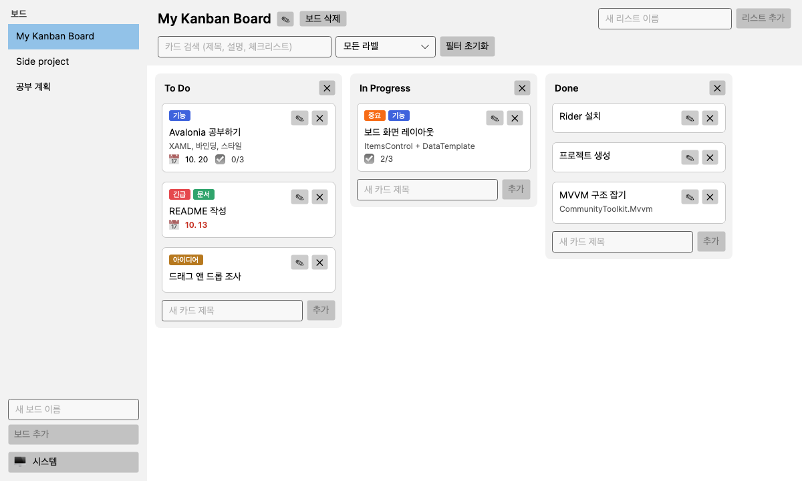
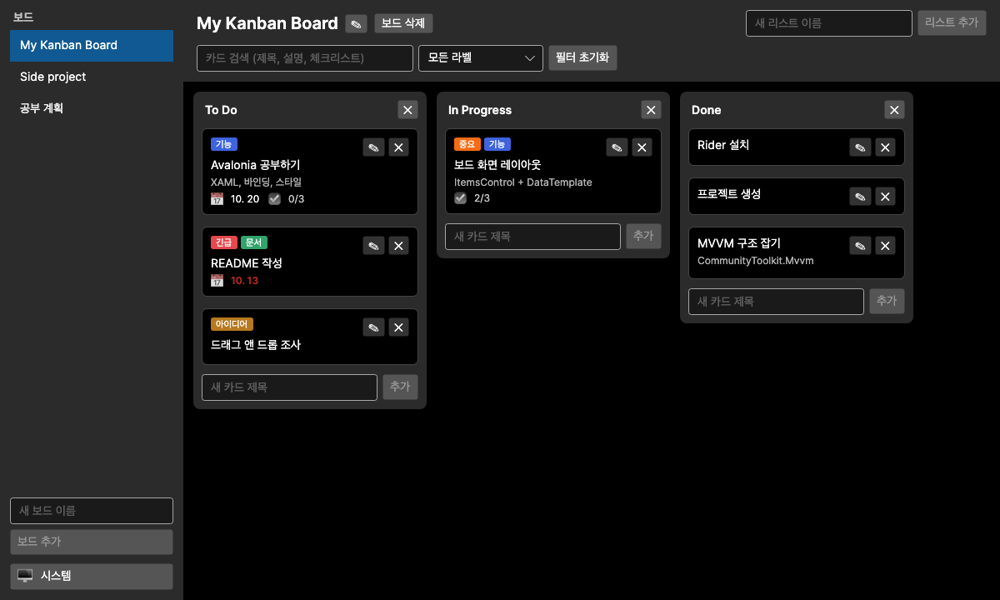
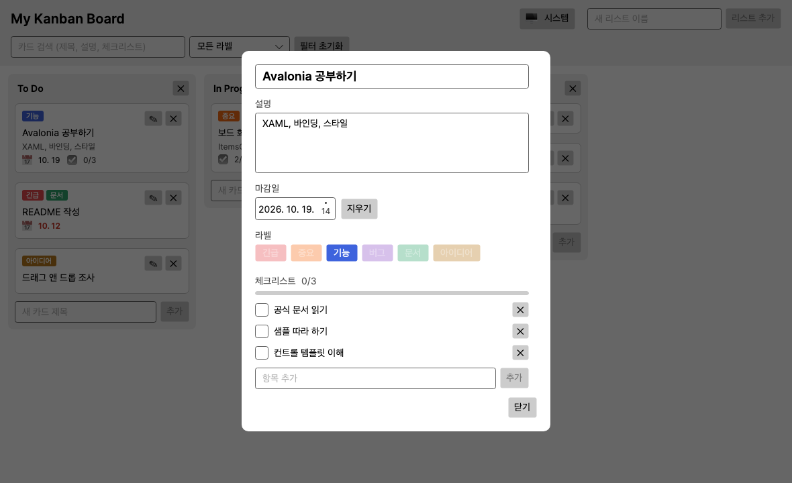

# Kanban

[](https://github.com/casey1425/Kanban/actions/workflows/ci.yml)

Avalonia UI와 MVVM 패턴으로 만든 크로스플랫폼(Windows / macOS / Linux) 데스크톱 칸반 보드 앱입니다.
Avalonia를 학습하면서 단계별로 기능을 쌓아간 개인 프로젝트입니다.



<details>
<summary>다크 테마 / 카드 상세</summary>





</details>

> 위 화면은 샘플 데이터로 렌더링한 이미지입니다.

## 기능

- [x] 실행 취소 / 다시 실행: 카드 이동·추가·삭제·수정, 리스트 추가·삭제를 되돌립니다 ([단축키](#단축키))
- [x] 여러 보드: 사이드바에서 만들기·전환·이름 변경·삭제 (마지막으로 본 보드를 기억)
- [x] 카드를 사이드바의 다른 보드로 끌어다 놓아 이동 (그 보드의 첫 리스트 맨 끝으로)
- [x] 보드, 리스트, 카드 표시
- [x] 카드 추가 / 삭제 / 제목 수정
- [x] 리스트 추가 / 삭제
- [x] 드래그 앤 드롭으로 카드 순서 변경 및 리스트 간 이동
- [x] SQLite 저장 (앱을 다시 켜도 보드가 유지됨)
- [x] 카드 상세: 설명, 마감일, 라벨, 체크리스트
- [x] 카드 검색(제목·설명·체크리스트)과 라벨 필터 (보드마다 따로)
- [x] 다크 / 라이트 / 시스템 테마 전환(설정 저장)
- [x] 저장 실패 시 오류 배너 표시

## 단축키

| 동작 | Windows / Linux | macOS |
|---|---|---|
| 실행 취소 | `Ctrl+Z` | `Cmd+Z` |
| 다시 실행 | `Ctrl+Shift+Z` 또는 `Ctrl+Y` | `Cmd+Shift+Z` |

- 사이드바의 **실행 취소 / 다시 실행** 버튼으로도 할 수 있습니다. 버튼에 마우스를 올리면 무엇을 되돌릴지 보입니다.
- 되돌리면 그 작업이 일어난 보드로 자동 이동합니다. 삭제한 카드·리스트는 라벨, 체크리스트, 마감일까지 **같은 Id로** 복원됩니다.
- 라벨과 체크리스트 변경, 보드 생성·삭제·이름 변경은 되돌릴 수 없습니다. 기록은 앱을 끄면 사라지고, 보드를 삭제하면 비워집니다.
- 카드 상세 패널이 열려 있는 동안에는 비활성화됩니다(편집 중인 카드가 사라지는 것을 막기 위해).

## 기술 스택

| 구분 | 사용 기술 |
|---|---|
| 언어 / 런타임 | C#, .NET 10 |
| UI 프레임워크 | [Avalonia](https://avaloniaui.net/) 12 |
| MVVM | [CommunityToolkit.Mvvm](https://learn.microsoft.com/dotnet/communitytoolkit/mvvm/) 8 |
| 데이터 | EF Core 10 + SQLite (마이그레이션 사용) |
| 구성 | Microsoft.Extensions.DependencyInjection |
| IDE | JetBrains Rider |

## 다운로드

[Releases](https://github.com/casey1425/Kanban/releases)에서 운영체제에 맞는 파일을 받을 수 있습니다.
.NET을 따로 설치할 필요가 없습니다(자체 포함 단일 실행 파일).

| 파일 | 대상 |
|---|---|
| `Kanban-win-x64.zip` | Windows (x64) |
| `Kanban-osx-arm64.tar.gz` | macOS (Apple Silicon) |
| `Kanban-osx-x64.tar.gz` | macOS (Intel) |
| `Kanban-linux-x64.tar.gz` | Linux (x64) |

> 서명하지 않은 앱이라 첫 실행 시 운영체제가 경고할 수 있습니다.
> macOS에서는 압축을 푼 뒤 `xattr -d com.apple.quarantine Kanban.App` 로 격리 속성을 제거하고 실행하세요.

## 소스에서 실행

[.NET 10 SDK](https://dotnet.microsoft.com/download)가 필요합니다.

```bash
git clone https://github.com/casey1425/Kanban.git
cd Kanban
dotnet run --project Kanban.App
```

### 테스트

```bash
dotnet test
```

- 저장소(SQLite)와 ViewModel 동작은 임시 DB를 만들어 실제로 저장하고 다시 불러오며 검증합니다.
- 마이그레이션은 "이전 버전 스키마의 DB에 데이터를 넣고 최신으로 올려도 보존되는지"까지 테스트합니다.
- 화면(XAML)은 Avalonia 헤드리스 렌더러로 그려서, 라벨 표시나 바인딩 오류 같은 문제를 확인합니다. 클릭, 드래그 앤 드롭, 키보드 단축키도 헤드리스에서 이벤트를 시뮬레이션해 검증합니다.
- GitHub Actions가 push마다 Ubuntu / Windows / macOS에서 빌드와 테스트를 실행합니다.

## 프로젝트 구조

```
Kanban/
├── Kanban.sln
├── Kanban.Core/          # 모델, IBoardRepository (UI·DB에 의존하지 않음)
├── Kanban.Data/          # EF Core DbContext, 저장소 구현, 마이그레이션
├── Kanban.Tests/         # xUnit: 저장소, ViewModel, 화면 스모크 테스트
└── Kanban.App/           # Avalonia UI
    ├── ViewModels/       # MainWindow(보드 목록·설정), Board, BoardList, Card, CardDetail ...
    ├── Views/            # *.axaml
    ├── Messages/         # ViewModel 간 메시지 (OpenCardRequested, ErrorOccurred, ActionPerformed)
    ├── Undo/             # 실행 취소 기록(UndoHistory)과 되돌릴 수 있는 작업들
    ├── Services/         # 설정 저장(JSON)
    └── ViewLocator.cs    # ViewModel → View 자동 연결
```

- **레이어 분리**: UI는 `IBoardRepository`만 알고, SQLite 구현은 DI로 주입됩니다.
- **MVVM**: View는 바인딩과 입력 이벤트만 다루고, 상태와 동작은 ViewModel이 가집니다.
- **ViewLocator**: ViewModel 이름 규칙으로 View를 자동 연결하므로 `ItemTemplate`을 따로 지정하지 않습니다.
- **Messenger**: 카드가 창을 직접 알지 못한 채 `OpenCardRequested` 메시지로 상세 패널을 요청합니다.
- **실행 취소**: ViewModel이 작업 후 `ActionPerformed` 메시지를 보내면 `UndoHistory`가 쌓습니다. 삭제는 스키마 변경 없이 "같은 Id로 다시 삽입"해 복원합니다(SQLite `AUTOINCREMENT`는 Id를 재사용하지 않습니다).
- **커맨드**: `[RelayCommand]`, `[ObservableProperty]` 소스 생성기로 보일러플레이트를 줄였습니다.

## 데이터 저장 위치

사용자 데이터 폴더의 `Kanban/` 아래에 저장됩니다. `kanban.db`는 보드 데이터, `settings.json`은 테마와 마지막으로 본 보드 같은 사용자 설정입니다.
(macOS/Linux: `~/.local/share/Kanban/kanban.db`, Windows: `%LOCALAPPDATA%\Kanban\kanban.db`)
앱 시작 시 마이그레이션이 자동으로 적용됩니다.

### 마이그레이션 추가 (개발자용)

```bash
dotnet tool restore
dotnet ef migrations add <이름> --project Kanban.Data --startup-project Kanban.Data
```

## 로드맵

| 단계 | 내용 | 상태 |
|---|---|---|
| 1 | 보드 / 리스트 / 카드 레이아웃 | 완료 |
| 2 | 카드·리스트 추가, 수정, 삭제 (MVVM, Command) | 완료 |
| 3 | 드래그 앤 드롭 | 완료 |
| 4 | SQLite(EF Core) 저장, 마감일 / 라벨 / 체크리스트 | 완료 |
| 5 | 테마, 검색 / 필터, 오류 알림, 설정 | 완료 |
| 마무리 | 단위 테스트(xUnit), GitHub Actions 크로스플랫폼 빌드 | 완료 |
| 릴리스 | `v*` 태그를 푸시하면 각 OS용 실행 파일을 자동 빌드해 배포 | v0.1.0 배포 |
| 확장 1 | 다중 보드 (기존 데이터를 기본 보드로 자동 이전) | 완료 |
| 확장 2 | 카드를 다른 보드로 이동 (사이드바로 드래그) | 완료 |
| 확장 3 | 실행 취소 / 다시 실행 | 완료 |
